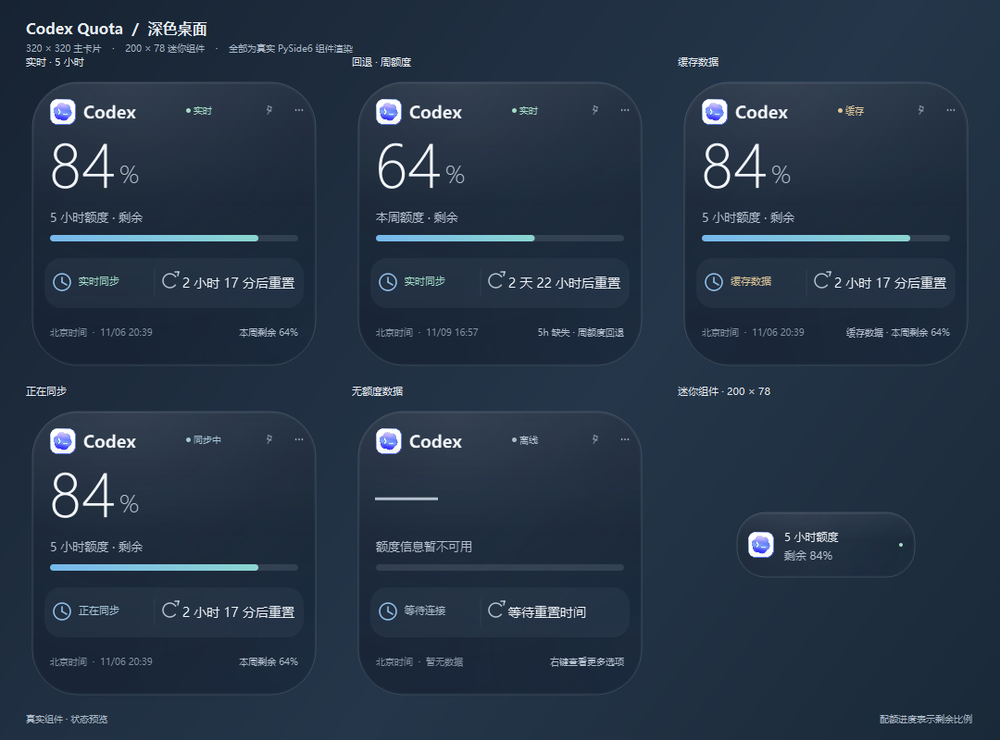

# CodexQuotaWidget

轻量的 Windows 桌面额度小组件：在桌面查看 Codex 的 5 小时额度、周额度和重置时间，也可通过仅监听本机的 HTTP API 读取整理后的用量数据。🔎



## ✨ 功能

- **两种桌面布局**：320 × 320 主卡片和 200 × 78 迷你组件，双击可切换。
- **额度回退**：优先显示有效的 5 小时额度；该额度不可用时显示周额度。
- **状态清晰**：显示剩余额度进度、同步状态、缓存状态、北京时间和重置倒计时。
- **Windows 桌面体验**：半透明磨砂面板、DPI 缩放、窗口拖动、置顶、系统托盘和可选开机启动。
- **本地 HTTP API**：组件与 API 共用缓存；服务仅绑定 `127.0.0.1`。
- **保护登录凭据**：自动读取本机 Codex 登录凭据，不需要粘贴浏览器 Token 或 Cookie。

## 🖥️ 环境要求

- Windows 10 或 Windows 11
- Python 3.10 或更新版本（从源码运行时）
- 使用 ChatGPT 账号登录的 Codex 桌面应用
- 首次安装依赖时需要网络连接

## 🚀 快速开始

克隆项目后，在项目目录双击 `Start-Widget.cmd`。脚本会在需要时创建 `.venv`、安装运行依赖并启动小组件：

```powershell
git clone https://github.com/likeyun/CodexQuotaWidget.git
Set-Location -LiteralPath '.\CodexQuotaWidget'
.\Start-Widget.cmd
```

也可以手动创建环境：

```powershell
py -3 -m venv .venv
& '.\.venv\Scripts\python.exe' -m pip install -r requirements.txt
& '.\.venv\Scripts\python.exe' -m quota_widget
```

程序默认同时启动桌面组件和 `http://127.0.0.1:18765` 上的 API。组件默认每 60 秒刷新一次；可在右键菜单中改为 120 秒或 300 秒。手动刷新也可从菜单中触发。

## 🔐 登录凭据

先在 Codex 桌面应用中登录 ChatGPT 账号，再启动小组件。默认从当前 Windows 用户的 `~/.codex/auth.json` 读取凭据。也可通过环境变量 `CHATGPT_ACCESS_TOKEN` 和可选的 `CHATGPT_ACCOUNT_ID` 提供凭据；未设置访问令牌时，文件路径按以下优先级选择：

1. `--auth-file '完整路径'`
2. `CODEX_AUTH_FILE` 环境变量
3. `CODEX_HOME` 目录下的 `auth.json`
4. 默认路径 `~/.codex/auth.json`

可用 OpenAI API Key 登录的账号不能用来读取 ChatGPT 订阅额度。程序只读取 Codex 管理的登录文件，不会修改或刷新该文件中的凭据。**不要提交、分享或粘贴 `auth.json`、访问 Token 或 Cookie。**

## 🌐 本地 API

默认地址：`http://127.0.0.1:18765`

| 方法与路径 | 用途 |
| --- | --- |
| `GET /api/usage` | 返回整理后的额度窗口、剩余比例、重置时间和上游原始数据 |
| `GET /api/health` | 检查本地服务是否运行；不代表上游额度请求成功 |

示例：

```powershell
curl.exe 'http://127.0.0.1:18765/api/usage'
curl.exe 'http://127.0.0.1:18765/api/health'
```

`/api/usage` 中常用字段：

- `windows.primary`、`windows.secondary`：额度窗口；不可用时为 `null`
- `remaining_percent`、`used_percent`：剩余和已用比例
- `reset_at`、`reset_at_beijing`：Unix 时间戳和北京时间
- `ok`、`stale`、`error`：请求状态与缓存状态
- `raw`：经过凭据字段清理的上游响应，便于排查接口结构变化

查询结果默认缓存 60 秒。网络失败时若有上次成功结果，API 会标记 `stale: true` 并继续返回旧数据；首次获取失败时返回 HTTP 503。服务只监听本机回环地址，并拒绝不匹配的 Host、跨域 Origin 和跨站浏览器请求。具有本机访问权限的程序可以读取此 API；不要通过反向代理或端口转发将它暴露到局域网或公网。

只启动 API：

```powershell
.\Start-API.cmd
```

或者使用命令行指定端口或凭据路径：

```powershell
& '.\.venv\Scripts\python.exe' -m quota_widget --api-only --port 18765
& '.\.venv\Scripts\python.exe' -m quota_widget --auth-file 'C:\path\to\auth.json'
```

## 🧪 演示、预览与测试

演示模式不会读取登录凭据、请求上游或启动 API：

```powershell
& '.\.venv\Scripts\python.exe' -m quota_widget --demo
& '.\.venv\Scripts\python.exe' -m quota_widget --render-preview '.\preview.png'
```

运行测试：

```powershell
& '.\.venv\Scripts\python.exe' -m unittest discover -s tests -v
```

## 📦 打包

在 Windows PowerShell 中运行：

```powershell
.\scripts\build.ps1
```

打包结果位于 `dist\CodexQuota\`。分发时请保留整个目录，而不只是 `CodexQuota.exe`。如需创建桌面快捷方式，可运行：

```powershell
.\scripts\create-shortcut.ps1
```

## 🧭 常用操作

- 右键打开菜单：切换大小、刷新、置顶、调整自动刷新、开启开机启动或退出。
- 拖动窗口：按住组件空白区域移动。
- 双击组件：在主卡片和迷你组件间切换。
- 关闭窗口：有系统托盘时会隐藏到托盘；从托盘菜单退出可结束程序。

窗口位置、大小模式、置顶状态和刷新间隔保存在 `%LOCALAPPDATA%\CodexQuota\settings.json`。

## ⚠️ 关于额度接口

额度数据来自 ChatGPT 网页使用的内部接口：`https://chatgpt.com/backend-api/wham/usage`。它不是稳定的公开 API，服务端可能随时更改协议、访问策略或响应字段。本项目按当前接口格式显示 Codex 额度；读取失败时请稍后重试或在 Codex 中重新登录。本项目为社区工具，与 OpenAI 或 Codex 官方无隶属关系。

## 📄 许可证

本项目以 MIT License 发布，详见 [LICENSE](LICENSE)。
